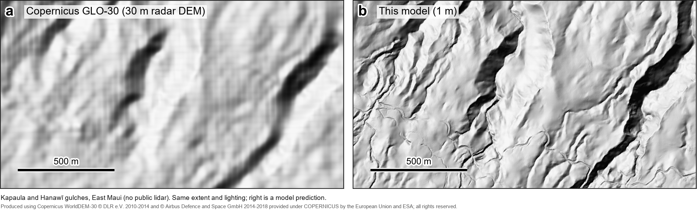
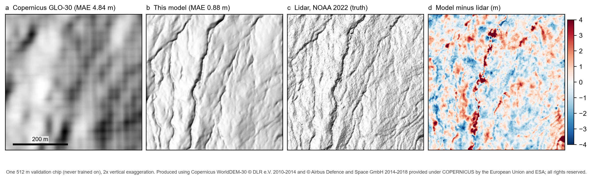
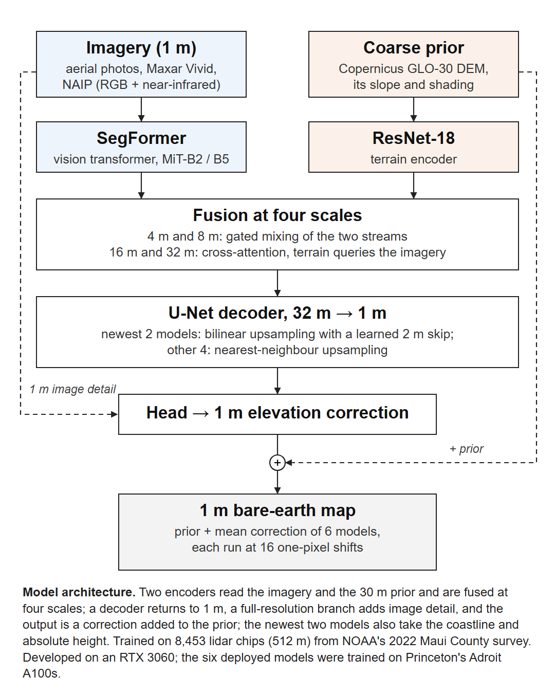

# canopy-to-ground

[](https://github.com/WilliamJudge808/canopy-to-ground/actions/workflows/ci.yml)

**Bare-earth terrain on a 1 m grid under rainforest canopy, predicted from aerial imagery and a 30 m global DEM.**

The 2020–2023 NOAA/USGS lidar survey of Maui County never covered windward East Maui; persistent low cloud kept the
aircraft out until acquisition ended in March 2023. That leaves about 490 km² of steep rainforest with nothing finer
than 30 m elevation data. This project trains a network that reads several years of aerial and satellite imagery
together with the Copernicus GLO-30 radar DEM, predicts the ground surface under the forest, and publishes the
result as an [interactive 3-D map](https://williamjudge808.github.io/east-maui-dtm/).

<p align="center">
  
</p>

[Results](docs/results.md) · [Method](docs/method.md) · [What mattered](docs/lessons.md) · [Data](docs/data.md) ·
[Model card](docs/model_card.md)

## Results

Absolute elevation error in metres, median (lower is better). Each row scores all surfaces on the same points.

| Test | Copernicus GLO-30 | FABDEM | **This model** |
|---|---:|---:|---:|
| Validation lidar chips: 1,107 chips in spatially separate 10 km blocks¹ | 1.27 | 1.25 | **0.46** |
| Wet east Molokaʻi, a region withheld from training² | 6.12 | 4.85 | **2.57** |
| ICESat-2 over East Maui, all ground segments³ | 1.49 | | **1.08** |
| ICESat-2 over East Maui, segments outside the lidar survey only⁴ | 2.30 | | **1.26** |

- **Against FABDEM.** The mean per-chip improvement over FABDEM, a global bare-earth DEM, is 1.09 m. Resampling whole
  10 km blocks gives a 95% interval of 0.79–1.65 m. The model is better in all 13 validation blocks and in every
  slope bin. On the withheld region the improvement is 2.54 m [1.78, 3.05].
- **Against published baselines.** Two guided depth super-resolution networks, FDKN and DKN, were retrained on the
  same chips. They reach 0.96 and 1.06 m, against 0.55 m for this model's first version (v1). Both baselines are
  about 57× smaller and were not trained to convergence.

¹ Per-chip MAE. These chips also guided design choices, so the next three rows are the out-of-sample evidence.
² A separate single model trained without the region (the published ensemble saw it).
³ Per-segment error against NASA laser altimetry after removing each overpass's vertical offset. The protocol and
pass rules were fixed before the check ran. The East Maui box includes some surveyed ground.
⁴ The same protocol restricted to unsurveyed ground. This subset was added after the pre-registered check.

<p align="center">
  
</p>

The panel above is a validation chip with the true lidar: the highest-relief chip with full lidar cover among those
where the model's error is 0.45–0.9 m. The model recovers the gulch network that the 30 m DEM blurs away. The error
map shows its main failure: it fills narrow gulch floors in by a few metres.

Full tables, ablations and negative results are in [docs/results.md](docs/results.md). Raw outputs are in
[`results/`](results).

## How it works



The network predicts a **correction to the 30 m DEM** (the *prior*), never absolute elevation. The prior is good
over distances of hundreds of metres and wrong at short ones, under canopy and on steep slopes. A residual keeps the
long-range shape and spends capacity where the prior fails.

- **Two encoders.** A SegFormer (MiT-B2 or B5) reads the imagery: County aerial photographs, Maxar Vivid, and NAIP
  RGB + near-infrared, plus a flag per layer marking where it has coverage. A ResNet-18 reads slope, shading and
  normalised height from the prior.
- **Fusion that depends on scale.** At 4 and 8 m per feature, a gate driven by the terrain stream decides how much of
  the imagery to admit. At 16 and 32 m, terrain features query the imagery with cross-attention, so the model can
  reason about drainage over the whole 512 m tile.
- **A full-resolution branch.** The U-Net decoder climbs back from 32 m to 1 m. A 1 m branch adds back fine image
  edges such as stream banks and road cuts.
- **A loss on each wavelength band.** Early versions emitted under half the true relief at 2–8 m, which is the
  error-minimising answer under uncertainty for a per-pixel loss. Per-octave correlation and amplitude terms on a Laplacian
  pyramid make it keep ridges and gulches ([`losses.py`](src/canopy2ground/losses.py)).
- **Ensemble.** The published map averages six models, each run at 16 one-pixel input shifts. The shifts remove a
  grid pattern that the first decoder imprinted ([details](docs/method.md#inference)).

Checks that the first version (v1) reads terrain from the imagery rather than sharpening the prior:
- **Swapped imagery.** Given another location's photographs, it does worse than predicting nothing at all (mean
  error 4.45 vs 4.01 m).
- **Effective resolution.** This is the shortest wavelength still matching lidar. It improves from 66 m to 42 m
  (median over 724 paired validation chips).

<br clear="right">

## Repository layout

```
src/canopy2ground/
  models/       TerrainFusionNet, fusion blocks, checkpoint I/O
  data/         memory-mapped chip dataset, on-device batch assembly, terrain features
  losses.py     band-wise detail / correlation / amplitude, spectral and sea-level terms
  train.py      config-driven training (AdamW, cosine schedule, staged encoder unfreezing, multi-size crops)
  metrics.py    per-chip evaluation and attribution decoys
  predict.py    tiled ensemble inference with shift averaging, streamed GeoTIFF output
  prefetch.py   imagery download for a region (kept separate so GPU jobs run offline)
  sources/      readers for County aerials, Maxar Vivid, NAIP and NOAA lidar
  build/        builds the training cache from public sources
  evaluation/   ensemble comparison, external DEMs (FABDEM, GEDTM30), ICESat-2
  mapping/      coastline masking, web-map tiling
  figures/      publication figures
configs/        training recipes for the three ensemble model types and the hold-out model
cluster/        Slurm scripts (train, prefetch, predict)
tests/          CPU unit tests on synthetic data
results/        raw outputs of the final evaluation
docs/           method, results, lessons, data sources and licences, model card
```

## Quick start

```bash
pip install -e ".[geo,dev]"
pytest
```

Train one ensemble member. This needs the training cache, which
`python -m canopy2ground.build` assembles from public sources ([docs/data.md](docs/data.md)).

```bash
python -m canopy2ground.train configs/b5_coast.yaml --seed 0 --out runs/b5_coast_s0
```

Predict a region with an ensemble:

```bash
python -m canopy2ground.prefetch --preset east_maui --prior data/priors/copernicus --out maps/store_east_maui
python -m canopy2ground.predict --checkpoint runs/*/model.pt --store maps/store_east_maui \
    --prior data/priors/copernicus --coastline data/coast/mauico_detailedcoast_county.geojson \
    --out maps/east_maui_dtm.tif --shift-tta 4
```

[`scripts/reproduce_map.sh`](scripts/reproduce_map.sh) runs the whole map pipeline end to end. The model was
developed on one RTX 3060 (12 GB). The six members of the published ensemble were trained on A100s, about 1.5 h
(MiT-B2) to 3 h (MiT-B5) each. Their checkpoints are not included in the repository. This package was refactored
from the research code that produced the map. On the real validation data it reproduces every number in
[`results/`](results), and the original checkpoints load unchanged.

## Limitations

- **There is no untouched test split.** The validation chips also guided design choices, and they come from the
  same lidar survey as the training labels. The withheld region and the ICESat-2 unsurveyed-ground row are the
  better guide to accuracy off the survey.
- **The grid is 1 m; the detail is not 1 m everywhere.** Measured effective resolution for v1 was 42 m at the
  median, with the finest quarter of chips below 23 m.
- **The error has a heavy tail.** Mean per-chip error on the validation chips is 2.66 m, against a median of
  0.46 m. Gulch floors, cliffs and closed canopy are the worst cases. v1 still sat about 0.9 m high under dense
  canopy where the prior sat 4.9 m high, and this has not been re-measured for the published ensemble.

More in [docs/results.md](docs/results.md#8-known-limitations).

## Data and licences

Code is MIT. The repository contains no imagery or elevation data. The published map is derived from Copernicus
GLO-30 (produced using Copernicus WorldDEM-30 © DLR e.V. 2010-2014 and © Airbus Defence and Space GmbH 2014-2018,
provided under COPERNICUS by the European Union and ESA; all rights reserved), NOAA 2022 lidar, USDA NAIP, Maxar
Vivid via the Hawaiʻi Statewide GIS Program, and County of Maui aerial imagery. Source terms are listed in
[docs/data.md](docs/data.md).
