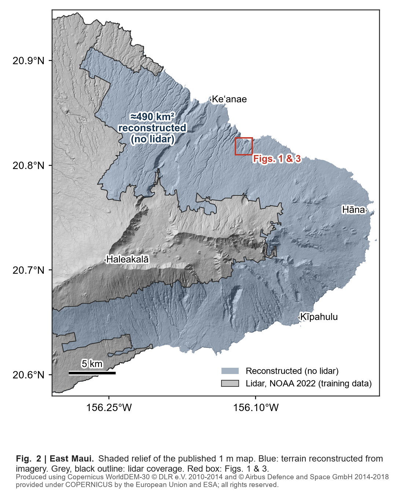
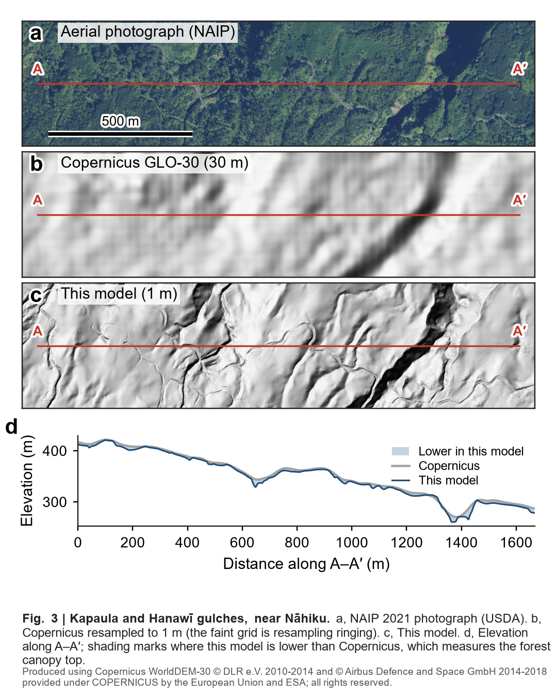

# Results

Model versions are defined in the first table. Analyses on v1 (input attribution, effective resolution, baselines) were
run on the first map's models and were not repeated for v3. Raw outputs of the final checks are in [`results/`](../results).

The network predicts a 1 m residual added to the Copernicus GLO-30 prior (lanczos-warped to 1 m). Imagery (Pictometry
RGB, Vivid, NAIP, availability planes) enters a SegFormer encoder and [dem_z, slope, hillshade] from the prior enter a
ResNet-18; gated fusion at 4/8 m, cross-attention at 16/32 m, a U-Net decoder and a 1 m high-frequency branch follow.
Labels are NOAA 2022 lidar DTM wherever it exists in Maui County; the deployment area is the unsurveyed part of East Maui.

| name | members | used in |
|---|---|---|
| v1 | 2 × MiT-B2, 22 epochs, seeds 0/1 | first map; attribution and effective resolution (§6); FDKN/DKN (§5) |
| v2 | 2 × MiT-B2 ([`b2.yaml`](../configs/b2.yaml)) + 2 × MiT-B5 ([`b5.yaml`](../configs/b5.yaml)), 66 epochs | second map |
| v3 | v2 + 2 × "R4" ([`b5_coast.yaml`](../configs/b5_coast.yaml): coast and elevation inputs, decoder v2), 66 epochs | **published map**, 16-shift TTA |

Elevation levels are in metres to 2 decimals; paired differences under 0.05 m use 3 decimals. The sign convention of
each paired difference is stated with its table.

## 1. Evaluation setup

All in-distribution numbers use one fixed validation set, scored at the final epoch with no checkpoint selection.

| item | definition |
|---|---|
| corpus | 512 × 512 m chips at 1 m on a fixed UTM grid; 8,453 train / 1,107 val, Maui County |
| val split | 10.24 km blocks (20 × 20 chips) hashed to val at 20%; train chips within 512 m of a val block excluded. The 1,107 val chips fall in 13 blocks. They were also used to choose between recipes, so there is no untouched test split |
| hold-out | wet east Molokai (east of 157.00° W, Kamakou massif), 1,211 chips; a ~2 km band on the dry side is excluded from training as well |
| per-chip MAE | mean \|pred − lidar\| over lidar ∧ prior-valid pixels; median and mean over chips |
| NMAD, LE90 | normalised median absolute deviation; 90th percentile of absolute error |
| ridge r (2–4 m r) | per-chip correlation with lidar in the 4–8, 8–16, 16–32 m Laplacian bands, mean of per-band medians (2–4 m band) |
| imagery-attributable r | ridge r (full input) − ridge r (scramble_rgb decoy: imagery from a chip half the corpus away). Wrong imagery is worse than none, so this is an upper bound on what the imagery contributes |
| effective resolution | wavelength where prediction–lidar coherence falls to 0.5; paired on chips where both curves reach 0.5 |
| sea false land | share of County-sea pixels predicted > 1 m |
| uncertainty | paired bootstrap over chips (4,000 draws). Chips within a block are spatially correlated, so chip-level intervals are too narrow; the headline comparisons are also given with whole-block resampling (§2). ICESat-2: bootstrap clustered by overpass (10,000 draws) |
| decision rule | a recipe counts as better only if a shape metric moves ≥ ~5× its seed spread at ≥ 2 seeds per arm, or MAE by ≥ 0.06 m. Two kept changes did not meet it (§7) |

Leakage was audited on the split, the inputs and the selection procedure. The split checks ran on the earlier 320-chip validation set, which used the same block and buffer rule.

| check | result |
|---|---|
| identity / content duplication across splits | none |
| distance from val chip to nearest train chip | minimum 1,024 m, median 2,560 m |
| excess similarity to nearest vs random train chip, 4–32 m bands | +0.001 to +0.013 at 1,024 m; ~0 beyond |
| val reuse for selection | an earlier protocol selected epochs on val[:128] (top scores inflated 0.04–0.10 r); replaced by unselected final-epoch scoring |
| v1, probe prefix val[:160] vs untouched val[160:] | median MAE 0.55 on both |
| v2, topo features and gate on lidar mask vs prior-valid mask | MAE median 0.47 / 0.47, ridge r +0.6549 / +0.6549 |

Pre-registered before any result: the attribution hypotheses H1–H3 (fixed endpoints, Holm within family, wet-Molokai
confirmatory set), the ICESat-2 protocol with one disclosed land-gate amendment, the canopy-bias criterion, and the
final checks in §2–§3 with their pass rules. Each scaling arm's prediction was written before its run. The ICESat-2
no-lidar subset (§3) was added afterwards.

## 2. Headline accuracy

On the 1,107 val chips, v3 is compared with two corrected-Copernicus products warped identically to the prior.

| surface | 1 m median | 1 m mean | 30 m median | 30 m mean |
|---|---|---|---|---|
| Copernicus GLO-30 | 1.27 | 4.01 | 1.15 | 3.89 |
| FABDEM v1-2 | 1.25 | 3.74 | 1.13 | 3.57 |
| GEDTM30 | 2.22 | 5.28 | 1.98 | 5.05 |
| **v3 (published)** | **0.46** | **2.66** | **0.35** | **2.52** |

| paired, FABDEM − v3 (per-chip MAE) | mean [95% CI] | chips where v3 is better |
|---|---|---|
| val, 1 m | +1.09 [+1.02, +1.17] | 99% |
| val, 30 m (both surfaces block-averaged over valid 30 × 30 m blocks) | +1.05 [+0.98, +1.12] | 99% |
| val, 1 m, resampling whole 10 km split blocks | +1.09 [+0.79, +1.65] | 13 of 13 blocks |
| wet Molokai hold-out, 1 m, resampling blocks | +2.54 [+1.78, +3.05] | 6 of 6 blocks |

v3 is better in every slope bin (0–5, 5–10, 10–20, > 20°); above 20° its median per-chip MAE is 1.21 m against FABDEM's 2.54 m.
FathomDEM was not tested (restricted access).

Model lineage on the same chips:

| model | MAE median | MAE mean | ridge r | 2–4 m r | imagery-attr. r |
|---|---|---|---|---|---|
| Copernicus prior | 1.27 | 4.01 | +0.281 | +0.015 | |
| v1 | 0.55 | 2.82 | +0.5986 | +0.316 | +0.4569 |
| 2 × mit_b2, 66 ep | 0.48 | | +0.6438 | +0.341 | +0.5112 |
| v2 | 0.47 | 2.67 | +0.6549 | +0.3514 | +0.5230 |
| R4 × 2 alone | 0.47 | 2.66 | +0.6589 | +0.3660 | +0.5341 |
| **v3** | **0.46** | **2.66** | **+0.6637** | **+0.3689** | +0.5321 |

Paired per-chip MAE, v1 − v2: +0.15 [+0.13, +0.18], v2 better on 87% of chips.

## 3. On-target check: ICESat-2 over East Maui

Left: the published map over East Maui. Blue is reconstructed from imagery and grey is lidar. Right: a transect
across Kapaula and Hanawī gulches, where no lidar exists. The panels show NAIP, Copernicus, the model and the
elevation profile.

ICESat-2 is the only elevation truth inside the deployment area. Pre-registered protocol: rms ≤ 2 m, ≥ 20 photons,
land gate h_prior ≠ 0, bilinear sampling, per-overpass median debiasing per surface, all surfaces on the same segments.
Delta = |err_A| − |err_B| per segment, median; positive means B is better.

| surface | median abs err | NMAD | LE90 |
|---|---|---|---|
| Copernicus prior | 1.49 | 2.22 | 7.48 |
| v1 | 1.09 | 1.61 | 4.01 |
| v2 | 1.08 | 1.60 | 3.73 |
| v3 | 1.08 | 1.60 | 3.68 |

| A → B | all segments [95% CI] | steepest quartile | pre-registered verdict |
|---|---|---|---|
| prior → v2 | +0.40 [+0.26, +0.64] | +0.71 | pass (CI > 0) |
| v1 → v2 | +0.007 [−0.005, +0.024] | +0.05 [+0.03, +0.11] | pass (lower bound > −0.05) |
| v2 → v3 | +0.004 [−0.000, +0.009] | | pass (v3 published) |

6,732 common land segments, 35 overpasses. The box includes lidar-covered slopes inside the training area.

**Added post hoc, not pre-registered:** the same protocol on segments outside the 2022 lidar outline only.

| surface | median abs err | A → B | delta [95% CI] |
|---|---|---|---|
| Copernicus prior | 2.30 | prior → v3 | +0.88 [+0.52, +1.39] |
| v1 | 1.31 | v1 → v3 | +0.04 [+0.02, +0.09] |
| v3 | 1.26 | | |

2,643 segments, 28 overpasses; v2 was not scored on this subset.

## 4. Generalisation: wet east Molokai hold-out

The published members trained on Molokai, so transfer is measured with separate models trained on all other islands and
scored on the 1,211 hold-out chips, one seed per arm. Differences are new − old.

| model | MAE median | ridge r | imagery-attr. r | 2–4 m r |
|---|---|---|---|---|
| Copernicus prior | 6.12 | | | |
| FABDEM v1-2 | 4.85 | | | |
| H5a: mit_b2, 22 ep | 3.00 | +0.5593 | +0.4141 | |
| H5b: mit_b2, 66 ep | 2.60 | +0.6007 | +0.4735 | +0.2210 |
| H6b: mit_b5 0.3×, v2 recipe | 2.69 | +0.5988 | +0.4782 | +0.2187 |
| **H6a: mit_b5 0.3×, R4 recipe** | **2.57** | **+0.6072** | **+0.4937** | **+0.2346** |

| paired | MAE | ridge r | imagery-attr. r |
|---|---|---|---|
| H5b − H5a | −0.14 [−0.21, −0.07], 71% | +0.0376, 98% | +0.0543, 95% |
| H6a − H6b | −0.12 (difference of medians) | +0.0084 | +0.0155 |
| FABDEM − H6a, 1 m / 30 m | +2.54 [+2.40, +2.69], 97% / +2.31 | | |

H6a sea false land is 0.030 (prior 0.089). Its hold-out median MAE (2.57 m) compares with 0.46 m for v3 on val.

## 5. Guided depth super-resolution baselines

FDKN and DKN were retrained on the same chips, prior, splits and metric, and compared with v1 at a similar wall-clock
budget.

| model | params | train samples | val median MAE | note |
|---|---|---|---|---|
| Copernicus prior | | | 1.27 | floor |
| DKN | ~0.69 M | 48k | 1.06 | ~7× slower per step; eval curve non-monotone (1.20 → 1.03 → 1.12 → 1.06) |
| FDKN | ~0.69 M | 160k | 0.96 | still descending at 40k steps (1.11 → 0.96) |
| v1 | 39.7 M per member | 186k | 0.55 | |
| v3 | | | 0.46 | reference only; longer schedule, larger ensemble |

Both baselines are undertrained and about 57× smaller, so this compares published architectures, not capacity- or budget-matched models. The
DKN figure is an upper bound on its error. A capacity- and budget-matched comparison was not run.

## 6. What the model uses

Input ablations on v1 (val, paired per chip, all Holm-corrected p < 0.001):

| condition | eff. res. (m), marginal | n | ΔMAE median, all | ΔMAE, steep quartile | chips worse |
|---|---|---|---|---|---|
| full | 46.8 | 868 | | | |
| no_vivid | 50.8 | 861 | +0.18 | +0.20 | 91% |
| no_naip | 56.2 | 836 | +0.15 | +0.20 | 91% |
| rgb_noise | 59.1 | 764 | +0.55 | +0.68 | 94% |
| no_extra (no Vivid, no NAIP) | 59.5 | 799 | +0.18 | +0.39 | 91% |
| prior_only | 66.4 | 728 | +0.59 | +1.33 | 98% |
| scramble_rgb | 75.5 | 570 | +0.81 | +1.91 | 99% |

Wrong imagery is worse than none: on val, scramble_rgb against prior_only gives mean MAE 4.45 vs 4.01 m, ridge r 0.14
vs 0.28 and effective resolution 75.5 vs 66.4 m. Pre-registered replication on wet Molokai (v1 training chips; contrasts
share chips): scramble_rgb − prior_only +1.00 m [0.79, 1.18]; prior_only − full +3.47 m [3.24, 3.66]; rgb_noise −
no_extra +0.47 m [0.42, 0.51].

Pre-registered channel and scale tests (wet Molokai, paired median ΔMAE):

| hypothesis | test | result | verdict |
|---|---|---|---|
| H2a: NIR is the most informative NAIP channel | Δ(NIR zeroed) − Δ(best visible) | green exceeds NIR by 0.13 m [0.09, 0.18] | refuted |
| H2b: NIR matters more under canopy | top − bottom vegetation tercile | +0.24 m [0.09, 0.39], p_Holm 0.0014 | confirmed |
| H3a: imagery information is local | Δ(16 px patch scramble) > Δ(64 px) | flat between 16 and 64 px | not confirmed |
| H3b | Δ(64 px) > Δ(256 px) | +0.28 m [0.21, 0.36] | confirmed |
| descriptive | intact 256 px blocks | retain ~74% of maximal damage; L50 > 256 px | |

The imagery signal sits in spatial arrangement above 256 m. Patch scrambles are off-manifold with a block-edge caveat,
and scales beyond the 512 m chip were not tested this way.

Effective resolution, paired on chips where both the prior and v1 reach coherence 0.5:

| set | n | prior | v1 | median paired ratio (IQR) | chips finer |
|---|---|---|---|---|---|
| val | 724 | 66.4 m | 42.1 m | 1.69× (1.17–3.39) | 97% |
| wet Molokai (v1 training chips) | 750 | 63.4 m | 27.5 m | 2.43× (1.78–3.36) | 99% |

On val the mean paired gain is 28.7 m [27.2, 30.1]; steep quartile 60.3 → 33.6 m, gentle quartile 91.0 → 74.0 m.
Prior band coherence is 0.061 at 48.5 m and 0.005 at 36.8 m, against 0.47 and 0.43 for v1.

Canopy bias (wet Molokai, signed median, exploratory): the prior sits +4.90 m high under dense canopy and +0.86 m on
open terrain; v1 reduces these to +0.93 m and +0.13 m.

## 7. Design decisions that were tested

(1 s) marks a single seed. MAE differences are new − old (negative = better). Seed spread within a recipe is about
±0.002 for ridge r and imagery-attr. r, and 0.023 m (range, three seeds at 66 epochs) for median MAE.

| decision | change | measured effect | kept |
|---|---|---|---|
| prior DEM (early, 320 val chips, 1 s) | SRTM → Copernicus GLO-30 | untrained prior MAE 3.24 → 1.64 m; best trained model on SRTM 2.49 m | Copernicus |
| band-correlation loss (early, 1,024 chips, 20 ep) | SSI + L1 → + per-octave correlation | ridge r +0.243 → +0.399; 2–4 m r +0.029 → +0.152 | yes |
| elevation storage | int16 decimetres → float32 | 2–4 m r +0.192 → +0.303 | float32 |
| prior resampling | bilinear → lanczos | prior MAE −0.11 overall, −0.22 steep quartile (120 val chips) | lanczos |
| schedule | 22 → 66 epochs, mit_b2 | MAE −0.12 [−0.14, −0.09], 74%; ridge r +0.0427, 98%; imagery-attr. +0.0550, 98%; replicated at seed 1; transfers (§4) | yes |
| depth at lr 0.1× | mit_b2 → mit_b3, 22 ep, 2 seeds | MAE −0.021 [−0.036, −0.006], 64%; ridge r +0.0018 | no (suggestive) |
| | mit_b2 → mit_b3, 66 ep (1 s) | MAE −0.006 [−0.026, +0.012]; ridge r −0.0014 | no |
| | mit_b2 → mit_b5, 22 ep (1 s) | MAE +0.006 [−0.007, +0.020]; ridge r +0.0027; train fit not improved | no |
| encoder lr | mit_b5, 0.1× → 0.3×, 22 ep (1 s) | ridge r +0.0093, imagery-attr. +0.0143, 76% | yes (single seed; below the decision rule) |
| depth at lr 0.3× | mit_b5 vs mit_b2, 66 ep, 2 vs 3 seeds | imagery-attr. +0.012; ridge r +0.0047; MAE no effect; 1.9× training cost | yes (v2 members) |
| batch size | 8 → 32, lr 2e-3, 22 ep (1 s) | ridge r −0.0145, worse on 82%; imagery-attr. −0.0086; MAE n.s. | no |
| seed | seed 0 → 1, identical recipe | MAE −0.009 [−0.020, +0.003], 49%; ridge r −0.0021 | reference |
| ensembling | 2 seeds, 22 ep, residual-averaged | MAE −0.014 ± 0.003 vs best member, 69% | yes |
| | add 2 × mit_b5 to 2 × mit_b2, 66 ep | MAE −0.020 [−0.028, −0.011], 75%; ridge r +0.0115, 95% | yes (v2) |
| | add 2 × R4 (v2 → v3) | MAE −0.016 [−0.023, −0.010], 71%; ICESat-2 +0.004 | yes (v3) |
| grid artefact | 16-shift TTA (0–3 px in x, y), on v2 | 4.0 m hillshade peak ×377–1,541 (v1: up to ×2,495) → none (lidar ×43–75); median / RMSE in 3 lidar boxes 1.12 / 2.85 → 1.11 / 2.82, 1.02 / 3.82 → 0.99 / 3.71, 0.31 / 1.20 → 0.33 / 1.17; 16× inference | yes |
| R4 bundle (2 seeds) | coast and dem/1000 inputs, sea supervision, prior-valid gating; bilinear decoder, H/2 stem skip, 48-channel 1 m end; crops 512/384/256 | ridge r +0.0085, imagery-attr. +0.0081, 2–4 m r +0.020, MAE +0.005 (null); sea false land 2.7–3.3% vs 8.4% prior; no 4.0 or 2.0 m peak without TTA | yes (v3), for the sea false-land and lattice fixes, not for accuracy; parts not isolated |
| context | 1024 m windows (1 s), mixed result | plain eval MAE 0.58 vs R4 0.49–0.51; padded eval imagery-attr. +0.546 vs +0.519–0.521, ridge r +0.616 vs +0.558–0.560 | no |
| canopy-bias loss | `w_bias` 0.3, pre-registered bar | wet Molokai canopy \|bias\| −0.26 [−0.33, −0.20]; canopy MAE +0.26; ridge r −0.046; val canopy MAE +0.12 | no (failed bar) |
| topo warm-up | prior channels blanked 3 epochs, ramped over 4 | imagery-attr. +0.4437 vs +0.4488; paired mean MAE +0.016 ± 0.007, steep quartile +0.089 ± 0.022 | no (null) |
| geometric augmentation | d8 rotation + mirror | imagery-attr. +0.3365 vs +0.4488; 2–4 m r +0.218 vs +0.303; MAE 0.75 vs 0.57; overfit gap −0.40 m | no (killed) |
| regularisers | drop-path 0.2; topo-dropout 0.25 + wd 3e-4 | null; overfit gap not reduced | no |
| error norm | L1 → MSE | 2–4 m r collapsed to +0.098 | no |
| speed | fused SDPA + fused AdamW | max \|Δ residual\| 7.2e-7; 1.06–1.39× step speed; 25–50% less peak memory | yes |
| | bf16 autocast | 0.92–0.97× step speed | no |
| | torch.compile | apparent 1.74–2.01× came with NaN loss in all 4 cells; train skill +0.06 m after 3 epochs | no (retracted) |

## 8. Known limitations

| limitation | evidence |
|---|---|
| residual high bias under closed canopy | v1 +0.93 m (prior +4.90 m), wet Molokai; a loss weight trades bias for MAE at ~1:1 (0.26 m each) |
| val labels share the training survey and islands | spatial blocks with a 512 m buffer; FABDEM is global and not fitted to Maui |
| out-of-distribution error is larger | hold-out median MAE 2.57 m; ICESat-2 1.08 m whole box, 1.26 m no-lidar subset; val 0.46 m |
| thin hold-out evidence | one seed per arm; hold-out models differ from deployed members; mit_b5 under the v2 recipe did not beat mit_b2 there |
| ICESat-2 measures relative accuracy | per-overpass median debiasing removes absolute offsets; samples are along-track only |
| heavy error tail | v3 mean per-chip MAE 2.66 m vs median 0.46 m |
| analyses on v1 only | attribution, effective resolution and canopy bias not rerun on v3; wet-Molokai confirmatory chips were v1 training chips, so absolute levels there are optimistic |
| effective-resolution selection | chips whose coherence never reaches 0.5 are excluded per condition |
| seed spread from 2–3 seeds | chip-level CIs exclude seed variance; ensemble CIs describe the trained models in hand |
| grid cause not ablated | stride-4 entry, skipless nearest upsampling and the 16-channel 1 m end are candidates; R4's fix is bundled; TTA accuracy rests on 3 boxes, Kula median 0.03 m worse |
| leakage audit predates the current corpus | run on the earlier 320-chip val set under the same block/buffer rule |
| no untouched test split | the 1,107 val chips chose between recipes; the hold-out region and ICESat-2 are the out-of-sample evidence |
| ICESat-2 cannot test 1 m detail | 40 m segments; the rms ≤ 2 m and ≥ 20-photon gates favour open canopy; the whole-box set includes surveyed (partly training) ground; FABDEM was not scored there |
| some analyses are not in this package | the v1 input ablations (§6), the effective-resolution analysis and the FDKN/DKN runs used the research code and are reported, not reproducible from here |

